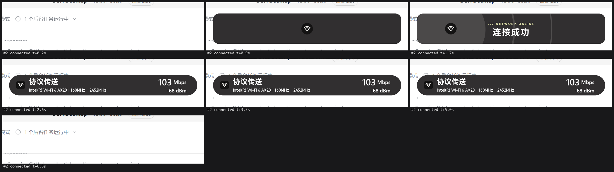
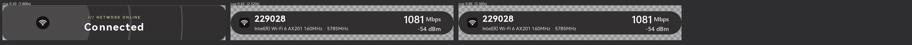
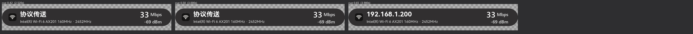

# NetworkHUD · 网络状态监测「灵动岛」

[简体中文](README.md) · [English](README_EN.md) · [日本語](README_JP.md)

仿照 [QinAnze/zmd-charge](https://github.com/QinAnze/zmd-charge)（笔记本电源状态灵动岛）
的 UI 与动画，用 **Python 3.12 + Win32 分层窗口**复刻的**网络适配器状态** HUD。

当任意网络适配器在「已断开连接 ↔ 已连接」之间变化时，从屏幕顶部居中弹出胶囊：
先弹出类型 logo → 胶囊撑高显示结果文案（**连接成功 / 断开连接 / DHCP异常**）→
收成信息胶囊显示详情（SSID、网卡名、频率、速率、信号）→ 停留后整体缩小收回。
点击 HUD 或托盘菜单都可提前收起。



---

## 快速开始

**第一次使用**（装依赖，只需一次）：

```bat
install.bat         :: 自动 pip install -r requirements.txt
```

需要 Python 3.9+（推荐 3.12）与 `pillow`、`numpy`、`pywin32` 三个库；
也可以手动 `python -m pip install -r requirements.txt`。

**日常运行**：

```bat
:: 方式一：双击（无控制台窗口，托盘常驻）
start.bat
stop.bat            :: 停止

:: 方式二：命令行
python -m net_hud                 :: 常驻监听
python -m net_hud --preview       :: 启动后立刻按当前网络状态播一次
python -m net_hud --demo          :: 依次播放三种状态（检查 UI 用）
python -m net_hud --state dhcp_failed --kind ethernet   :: 播放指定状态后退出
```

**开机自启动**：

```bat
install_autostart.bat      :: 添加（在「启动」文件夹建一个快捷方式）
uninstall_autostart.bat    :: 移除
python tools\autostart.py --status      :: 查看当前状态
```

它只是往 `%APPDATA%\Microsoft\Windows\Start Menu\Programs\Startup\NetworkHUD.lnk`
放一个快捷方式（目标 = `pythonw.exe run.pyw`），所以能在「任务管理器 → 启动」里
看到、禁用，或直接删掉；不需要管理员权限，也不写注册表。

托盘图标（通知区域）左键 = 预览当前状态，右键 = 菜单（预览三种状态 / 打开日志目录 / 退出）。
日志：`%TEMP%\NetworkHUD\log-YYYYMMDD.txt`。

---

## 配置文件

首次运行时会在项目根自动生成 **`config.json`**（UTF-8，允许 `//` 与 `#` 整行注释）。
**改完保存即可，不必重启** —— 程序在每次触发前会检查文件有没有变，变了就重新载入，
其中缩放倍率会立刻调整窗口（实测运行中把 `scale` 从 1 改成 1.7，下一次触发时窗口
直接从 672×108 变成 1142×184，仍然贴顶居中）。只有 `grace` / `poll` / `ignore`
这三项影响监听线程，需要重启才生效。命令行参数只覆盖你显式给出的那一项；
手写坏了也不怕，解析失败会在日志里警告并退回默认值。

```jsonc
{
  "scale": 1,             // 缩放倍率 1.0 = 默认大小（0.35 ~ 4.0）
  "label_hold": 3,        // SSID / 适配器名称显示几秒，之后该区域换成 IP
  "total": 12,            // 整个窗口的总时长（胶囊出现 → 完全消失）
  "duration": 6,          // 入场动画基线时长（3 ~ 10）
  "grace": 10,            // DHCP 宽限秒数
  "poll": 2,              // 兜底轮询间隔
  "ignore": [],           // 追加忽略的适配器关键字
  "prefer_ipv6": false,   // 同时有 v4/v6 时优先显示哪个
  "swap_to_ip": true,     // 是否启用「名称 → IP」切换
  "lang": "cn"            // 界面语言：cn / en / jp
}
```

* **缩放倍率**：`scale` 只改显示大小，**窗口永远贴在工作区顶部并水平居中**
  （顶边固定距顶 48 逻辑像素，与倍率无关；倍率过大时两侧对称溢出，仍是居中）。
  实测本机（2560 宽、dpi 144）`scale` 取 0.5/1/2/3 → 窗口 336×54 / 672×108 / 1344×216 / 2016×324，
  胶囊中心恒为 `x=1280`、顶边恒为 `y=72`。
* **`total` 与 `label_hold` 的关系**：信息页停留时间 = `total − 入场动画 − 收尾动画`，自动推算。
  默认 `total=12` → 入场 5.16s + 停留 6.66s + 收尾 0.18s。`total` 太小或 `label_hold` 超过停留时间时，
  启动日志会给出提示（此时 IP 可能来不及显示）。
* **换 IP 的计时起点**：从**信息页出现**的那一刻（cue `0.42`，基线 6s 时约 2.52s）算起，
  `label_hold` 秒后把左侧第一行由 SSID / 适配器名换成该适配器的 IP，直到窗口关闭。
* **IP 写法**：只显示地址本身（不带 `IP` 前缀），IPv6 用小写十六进制（如 `2408:8214:5b3a:1f00:...:7a8b`），
  IPv4 用十进制（如 `192.168.3.51`）。长 IPv6 会自动缩小字号以放下，仍放不下才加省略号。
* `python -m net_hud --show-config` 可打印当前实际生效的配置与时间分配。

---

## 界面语言

`config.json` 的 **`lang`** 决定 HUD 与托盘菜单的文字，可选 `"cn"`（简体中文，默认）、
`"en"`（English）、`"jp"`（日本語）；也接受 `zh-CN`、`ja`、`English` 这类写法，
认不出来会在日志里警告并退回 `cn`。命令行 `--lang en` 可临时覆盖。

| 位置 | cn | en | jp |
| --- | --- | --- | --- |
| 连接成功 | 连接成功 | Connected | 接続成功 |
| 断开连接 | 断开连接 | Disconnected | 通信切断 |
| DHCP 异常 | DHCP异常 | DHCP Failed | DHCPエラー |
| 托盘 · 预览当前状态 | 预览当前网络状态 | Preview: Current Connection Status | 今のネットワーク状態をプレビュー |
| 托盘 · 打开日志目录 | 打开日志目录 | Open logs dir | ログフォルダーを開く |
| 托盘 · 退出 | 退出 | Exit | プログラムを終了する |

界面文字用项目自带的 HarmonyOS Sans SC（原项目首选字体），它同时覆盖简体中文与日文假名，
所以切到日文不需要另装字体。第一页的 `/// NETWORK ONLINE` 等 tagline 是原项目的设计元素，
三种语言下都保持英文。改完 `config.json` 保存即可切换（下一次触发时生效，托盘菜单同步更新）。



---

## 触发规则

| 事件 | 条件 | 结果 |
| --- | --- | --- |
| 适配器上线 | `oper_status` 由断开变为 Up，且**已有非 169.254 的 IP** | 立刻显示 `connected` |
| 适配器上线（DHCP 未就绪） | 上线时 IP 为空或全是 `169.254.*` | 进入 **10 秒宽限期**轮询 |
| └ 宽限期内拿到 IP | `--grace` 秒内出现非 `169.254.*` 地址 | 立刻显示 `connected` |
| └ 宽限期结束仍无 IP | 超过 `--grace`（默认 10）秒 | 显示 `dhcp_failed` |
| 适配器下线 | `oper_status` 由 Up 变为断开 | 显示 `disconnected` |

* 即时性：注册 `NotifyIpInterfaceChange`（IP Helper API）做事件驱动，另有 `--poll`（默认 2s）兜底轮询。
  实测断开事件到 HUD 弹出延迟约 **0.3 s**。
* 只对**变化**作出反应，程序启动时已在线的适配器不会触发。
* 忽略虚拟网卡（名称/描述含 `Microsoft Wi-Fi Direct Virtual Adapter`、`Wi-Fi Direct`），
  可用 `--ignore 关键字1,关键字2` 追加。

## 三种状态

| state | 第一页文案 | tagline | logo |
| --- | --- | --- | --- |
| `connected` | 连接成功 | `/// NETWORK ONLINE` | 按适配器类型（见下） |
| `disconnected` | 断开连接 | `/// LINK DOWN` | `nointernet` |
| `dhcp_failed` | DHCP异常 | `/// DHCP FAILED` | `nointernet`（副行显示当前 IP） |

logo 沿用原项目「电标」的走位：先在胶囊中央弹出，再向左滑动，最终停在信息页最左端。

## 适配器分类

| kind | 判定 | logo |
| --- | --- | --- |
| `wifi` | `if_type == IEEE80211`，或名称/描述含 `WLAN`/`Wi-Fi`/`wireless`/`无线` | `wifi.png` |
| `btpan` | 名称/描述含 `Bluetooth`/`蓝牙` | `btpan.png` |
| `usb_rndis` | 名称/描述含 `NDIS`（含「以太网」的 NDIS 适配器归此类，对应手机 USB 网络共享） | `usb_rndis.png` |
| `ethernet` | 其余有线适配器 | `ethernet.png` |

`assets/` 里的二值图会自动处理：白底素材**取反**为黑底白字，再按字形 bbox 裁掉留白，
放进深色圆角底板（`#141313`）里绘制；圆角状态用实心圆底、信息页用方形底板。

## 信息页布局

| 适配器 | 左列 | 右列 |
| --- | --- | --- |
| WiFi | 上行（较大字）WiFi SSID；下行（较小字）`网卡名 · 频率MHz` | 链接速率 `1081 Mbps`；下行信号强度 `-54 dBm` |
| 非 WiFi | 仅适配器名称（单行垂直居中） | 仅连接速率 `1.0 Gbps` |

左列文字宽度会按右列**逐行**计算的可用宽度裁剪，超长时加省略号（右列不会被压掉）。

**「名称 → IP」定时切换**：连接成功后，左列第一行先显示 SSID / 适配器名称，
`label_hold` 秒（默认 3s）后原地换成该适配器的 IP，直到窗口关闭。第二行与右列全程不变、版式不位移。

| 时刻（默认配置） | 左列第一行 | 左列第二行 | 右列 |
| --- | --- | --- | --- |
| 2.52s ~ 5.52s | `229028` | `Intel(R) Wi-Fi 6 AX201 160MHz · 5785MHz` | `1081 Mbps` / `-54 dBm` |
| 5.52s ~ 关闭 | `192.168.3.51` | 同上（不变） | 同上（不变） |



## 命令行参数

下面前 5 项与 `config.json` 同名，**不给就用配置文件里的值**。

| 参数 | 说明 |
| --- | --- |
| `--config PATH` | 指定配置文件（默认项目根 `config.json`） |
| `--scale F` | 覆盖缩放倍率 |
| `--label-hold S` | 覆盖「名称显示时长」 |
| `--total S` | 覆盖窗口总时长 |
| `--duration S` | 覆盖动画基线时长（内部限制 3~10） |
| `--grace S` / `--poll S` | 覆盖 DHCP 宽限 / 兜底轮询间隔 |
| `--ignore LIST` | 追加忽略的适配器关键字，逗号分隔 |
| `--prefer-ipv6` / `--no-prefer-ipv6` | 覆盖「优先显示 IPv6」 |
| `--no-swap` | 关闭「名称 → IP」切换 |
| `--lang cn\|en\|jp` | 覆盖界面语言 |
| `--show-config` | 打印生效配置后退出 |
| `--preview` | 启动后先播一次 |
| `--state` / `--kind` | 播放指定状态（`connected`/`disconnected`/`dhcp_failed`）与示例类型后退出 |
| `--demo` | 依次播放三种状态后退出 |
| `--no-tray` | 不建托盘图标 |
| `--quit` / `--restart` | 通知在运行的实例退出 / 重启 |

## 目录结构

```
config.json       配置文件（首次运行自动生成）
requirements.txt  依赖清单（pillow / numpy / pywin32）
README.md         简体中文说明 / README_EN.md 英文 / README_JP.md 日文
install.bat       安装依赖
start.bat         后台启动 / stop.bat 停止
install_autostart.bat     添加开机自启动 / uninstall_autostart.bat 移除
net_hud/
  __main__.py      python -m net_hud 入口
  config.py        配置文件读写、默认值、钳制与描述
  i18n.py          界面文案表（cn / en / jp）
  app.py           单实例、托盘菜单、主循环、命令行
  watcher.py       适配器状态监听 + DHCP 宽限状态机
  netinfo.py       IP Helper API 枚举适配器（无子进程，含 IPv4/IPv6）
  wlaninfo.py      netsh wlan show interfaces 解析（中英文标签）→ SSID/频率/速率/dBm
  content.py       状态 → 页面文案/logo/数值（含「名称 → IP」置换）
  hud.py           分层窗口 + 60fps 帧循环 + 名称/停留/收尾/换 IP 排期
  anim.py          关键帧时间线（1:1 复刻 HudAnimations.cs 的 cue 体系）
  easing.py        KeySpline 三次贝塞尔求值
  renderer.py      一帧 RGBA 直接绘制（numpy 抗锯齿胶囊/波纹）
  theme.py         颜色/字体/尺寸（对应 HudTheme.axaml）
  logos.py         素材加载、取反、裁切、着色
  tray.py          托盘图标与右键菜单（Shell_NotifyIcon）
  win32ui_ext.py   UpdateLayeredWindow 分层窗口、DPI 感知
tools/
  autostart.py     开机自启动开关（写/删「启动」文件夹里的快捷方式）
  preview.py       静态渲染拼图（cues 任一时刻），UI 核对用
  smoke.py         真机冒烟：把 HUD 显示出来并在指定时刻截屏
  live_test.py     真机端到端：真实断开/重连 WLAN，验证触发链路并自动截图
  test_watcher.py  状态机自测（伪造快照，覆盖上线/下线/DHCP宽限/忽略）
  test_netinfo.py  netinfo 自测（手工构造 IPv6 链表，覆盖压缩/过滤/选择）
  test_wlaninfo.py wlaninfo 自测（中文/英文标签、十六进制与 GBK/UTF-8 的 SSID、未连接）
```

## 实现要点

* **分层窗口逐像素透明**：`WS_EX_LAYERED|WS_EX_TOOLWINDOW|WS_EX_NOACTIVATE` +
  `UpdateLayeredWindow(ULW_ALPHA)`，每帧把**预乘 alpha 的 BGRA** 写进 `CreateDIBSection`
  （top-down 32bpp）。不用色键，所以圆角与波纹没有毛边。
* **缩放在绘制阶段完成**：`base_scale = 0.8 × (dpi/96) × scale`（0.8 是原项目的 GlobalScale，
  `scale` 来自配置文件），所有坐标/字号都乘该系数，全程不做位图 resize，
  所以任意倍率下文字都按最终像素尺寸渲染，不会糊。
* **定位**：窗口顶边固定在工作区顶部下方 48 **逻辑**像素（再乘 dpi 缩放），水平严格居中，
  所以倍率只影响大小、不影响「贴顶居中」。
* **动画时间线 1:1 复刻**：原项目 `Animations/HudAnimations.cs` 的 14 个 cue 常量
  （`TExpand=0.12`、`TMove=0.20`、`TTitle=0.25`、`TContract=0.36`、`TNumReady=0.42`、
  `THoldC=0.86`、`TClose=0.89` …）、`MapCue` 归一化分段、以及 `KS_In/Out/InOut/Smooth/BackOut`
  各段独立的 KeySpline 都已照搬，入场段绝对时长恒为 2.52 s。
* **波纹方向**：`connected` 向外扩散（`Ripple`，三圈 1.5/2.0/2.5 倍），
  `disconnected` / `dhcp_failed` 从两端向内收拢并被 logo 吸走（`RippleIn`），与原项目插电/拔电一致。

## 开发工具

```bat
python tools\preview.py --state connected --kind wifi --label-hold 1 --cues 0.42,0.65,0.86
python tools\preview.py --state connected --kind wifi --ipv6 --label-hold 1    :: 看长 IPv6 缩字号
python tools\preview.py --state connected --kind wifi --lang jp                :: 看日文界面
python tools\smoke.py   --state connected --kind wifi --scale 2 --label-hold 1
python tools\live_test.py --profile <你的WiFi配置名>          :: 会真实断开/重连 WLAN
python tools\test_watcher.py
python tools\test_netinfo.py
python tools\autostart.py --status
```

## 已知限制

* 需要 Windows 10/11 + Python 3.9 或更高（开发环境为 3.12；依赖 pillow / numpy / pywin32）。
* 非管理员权限即可运行；但普通用户无法启用/禁用适配器，故真机端到端测试通过
  `netsh wlan disconnect/connect` 完成。
* WiFi 详情来自 `netsh wlan show interfaces`，中文与英文标签都已适配；
  信号强度 dBm 由百分比按 `pct/2 - 100` 估算（Windows 不直接提供 dBm）。
* 802.11 的 SSID 是裸字节数组，`netsh` 只要遇到非 ASCII 字节就不按文本打印，而是打印其十六进制
  （如 `创新实验室` → `E5889BE696B0E5AE9EE9AA8CE5AEA4`，正是它的 UTF-8 字节）。程序会按
  UTF-8、本机 OEM 代码页依次还原；实在还原不出可读文本时退回 Profile 名。纯 ASCII 的 SSID
  永远不会被十六进制化，所以不会误伤。`tools/test_wlaninfo.py` 覆盖这些情形。
* 只监听适配器状态变化，不做连通性探测（是否能上外网不在判定范围内）。
* 本机（以及多数默认配置的 Windows）所有适配器的「Internet 协议版本 6 (TCP/IPv6)」都是关闭的，
  真机上不会取到 IPv6 地址、也就不会显示 IPv6；IPv6 的压缩、链路本地/未完成地址过滤与优先级
  选择逻辑由 `tools/test_netinfo.py` 手工构造 `IP_ADAPTER_UNICAST_ADDRESS` 链表覆盖（20 项断言）。
  想真机验证可先在网卡属性里勾选 IPv6，或把 `prefer_ipv6` 设为 `true`。

参考项目 [zmd-charge](https://github.com/QinAnze/zmd-charge) 为 MIT 许可。
